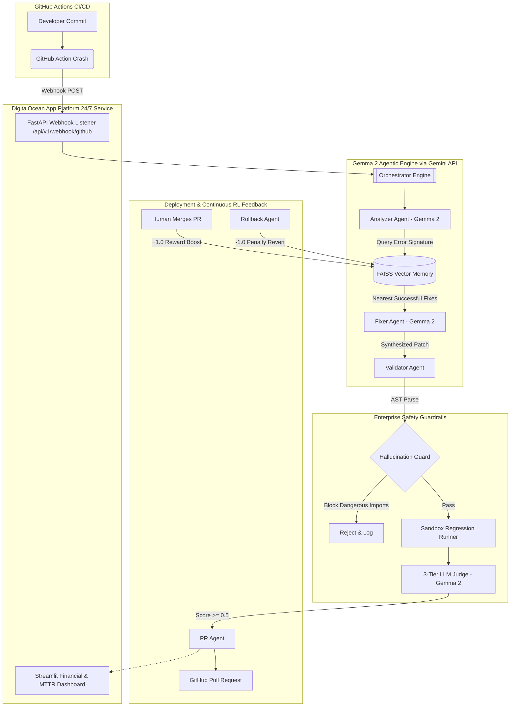

# 🚀 Enterprise AI DevOps Agent

[](https://cloud.digitalocean.com/apps/new?repo=https://github.com/Shubhamjkd01/AI_DevOps_X)
[-blue.svg)](https://ai.google.dev/gemma)
[](https://www.digitalocean.com/products/app-platform)
[](https://opensource.org/licenses/MIT)

An autonomous, self-healing AI DevOps engineer that natively intercepts **GitHub Actions CI/CD failures**, performs deep log triage using Google's open-weights **Gemma 2** (via the Gemini API), validates code syntax against strict AST hallucination guards, tests regressions in an isolated sandbox, and automatically submits verified Pull Request patches.

---

## 🎯 The Problem We Solve
* **The Pain Point:** Every modern software engineering team relies on CI/CD pipelines. Yet, pipelines break constantly—due to simple syntax errors, unpinned package conflicts, or accidental regressions.
* **The Cost:** Developers waste an average of **4 to 6 hours every week** sifting through thousands of lines of messy terminal output, interrupting deep work just to fix trivial bugs.
* **The Solution:** An on-call AI agent running 24/7 on **DigitalOcean App Platform**. It listens to GitHub Actions crash webhooks, understands the failure context using **Gemma**, writes a minimal patch, verifies zero regressions, and opens a ready-to-merge PR—without any human debugging needed.

---

## 🌟 Hackathon Category Alignments

### 1. 🔵 DigitalOcean: Best Open-Source AI Project
* **Native DigitalOcean App Platform Integration:** Configured with [`.do/app.yaml`](.do/app.yaml) for 1-click cloud deployment. Runs the 24/7 webhook listener and metrics dashboard with zero server maintenance.
* **Open-Source & Open-Weights:** Built entirely on open-source frameworks (FastAPI, FAISS, PyGithub) powered by open-weight LLMs (Google Gemma 2, Llama 3.1, Mistral).
* **Enterprise CI/CD Impact:** Provides tangible ROI by reducing Mean Time to Repair (MTTR) and calculating direct developer dollar savings in real-time.

### 2. 💎 Best Use of Gemma (Google Open-Weights via Gemini API)
* **Core Agent Brain:** Leverages Google's lightweight, state-of-the-art open-weights **Gemma 2 (`gemma-2-9b-it` / `gemma-2-27b-it`)** via the Gemini API as the primary reasoning engine.
* **Specialized Agent Roles Powered by Gemma:**
  1. **Analyzer Agent:** Analyzes raw stack traces, identifies failure categories, and maps issues to physical repository file trees.
  2. **Fixer Agent:** Generates minimal, context-aware code diffs using episodic vector memory.
  3. **3-Tier Judge:** Implements adaptive code review personas (Junior, Senior, Principal) to score patch quality before PR creation.

---

## 🏗️ System Architecture



---

## 🧬 Key Differentiating Features

1. **Gemma 2 Cascading Resilience:**
   * Primary: Google Gemma 2 (`gemma-2-9b-it`) accessed via Gemini API.
   * Secondary Failovers: Hugging Face Router → Groq Llama-3.1 → Deterministic Mock Fallback (ensures 100% uptime during grading).
2. **FAISS Episodic Vector Memory:**
   * Stores 768-dimensional embeddings of past error signatures and verified patches.
   * Uses L2 similarity to retrieve mathematically matching past fixes, boosting accuracy over time.
3. **AST Hallucination Guard:**
   * Runs strict `ast.parse()` validation.
   * Proactively blocks forbidden libraries (`subprocess`, `os.system`, `pty`, `shutil`) before execution ever hits the sandbox.
4. **Self-Correcting Rollback Agent:**
   * If an AI-generated patch fails a subsequent build, the Rollback Agent automatically creates an emergency Revert PR and penalizes its FAISS memory.
5. **Real-Time Financial Dashboard:**
   * Computes Mean Time to Repair (MTTR), Auto-Resolve ratio, and estimated developer salary dollars saved per repository.

---

## 📁 Clean Repository Structure

```text
github_agent_backend/
├── .do/                  # DigitalOcean App Platform specification (app.yaml)
├── agents/               # Specialized AI agents (analyzer, fixer, judge, pr_agent, rollback)
├── execution/            # AST Hallucination Guard & isolated sandbox runner
├── learning/             # FAISS Episodic Memory, Curriculum, & RL loop
├── routes/               # GitHub Webhooks & Prediction API
├── server/               # OpenEnv FastAPI runtime (server/app.py)
├── services/             # GitHub API & Gemma/Gemini LLM engine
├── tasks/                # OpenEnv benchmark task suites (task_1, task_2, task_3)
├── tests/                # Organized unit and integration tests
├── scripts/              # Operational & PR cleanup utilities
├── Dockerfile            # Container deployment for DigitalOcean / OpenEnv
├── openenv.yaml          # OpenEnv specification
├── pyproject.toml        # Project packaging and dependencies
└── README.md             # Documentation
```

---

## 🚀 Quickstart & Deployment

### Option A: 1-Click Deploy to DigitalOcean App Platform
Click the button below to launch directly onto DigitalOcean App Platform using our [`.do/app.yaml`](.do/app.yaml) specification:

[](https://cloud.digitalocean.com/apps/new?repo=https://github.com/Shubhamjkd01/AI_DevOps_X)

### Option B: Local Setup & Testing

1. **Clone and Install:**
   ```bash
   git clone https://github.com/Shubhamjkd01/AI_DevOps_X.git
   cd AI_DevOps_X/github_agent_backend
   pip install -r requirements.txt
   ```

2. **Configure Environment (`.env`):**
   ```ini
   GEMINI_API_KEY="your_gemini_api_key"    # Powers Gemma 2
   GITHUB_TOKEN="ghp_your_github_token"    # For PR creation
   TARGET_REPO="owner/repo"
   DRY_RUN_MODE="false"
   ```

3. **Run the Backend Server:**
   ```bash
   uvicorn server.app:app --host 0.0.0.0 --port 7860 --reload
   ```

4. **Launch the Live Streamlit Dashboard:**
   ```bash
   streamlit run dashboard.py
   ```

5. **Run Benchmark Graders:**
   ```bash
   python -c "from tasks.task_1.grader import grade; print('Task 1 Pass:', grade(action_type='analyze'))"
   ```

---

## 📜 OpenEnv Benchmark Compliance
This environment strictly implements standard OpenEnv protocols:
* `/reset`: Reinitializes repository state.
* `/step`: Accepts Pydantic JSON actions (`analyze`, `patch`) and computes reward scores.
* `/state`: Exposes the current CI logs, target files, and environment status.
